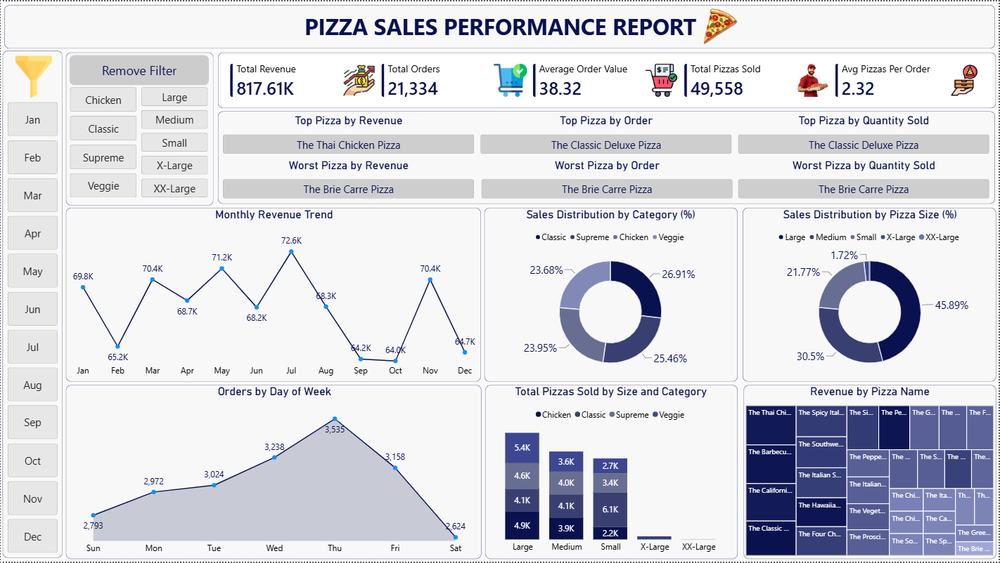

# 🍕 Pizza-Sales-Analysis-PowerBI
Pizza Sales Data Analytics project using Power BI, Power Query, DAX, PostgreSQL/SQL, and Excel/CSV to analyze sales performance, revenue trends, orders, pizza categories, sizes, and product performance.

## 📊 Project Overview
This project analyzes pizza sales data to understand sales performance, revenue trends, customer ordering patterns, pizza category performance, pizza size performance, and individual pizza product performance. An interactive Power BI dashboard was developed to transform raw sales data into meaningful business insights using SQL analysis, Power Query, DAX calculations, and data visualization.

## 📷 Dashboard Preview

## 🎯 Project Objectives
- Analyze overall pizza sales performance
- Track revenue and order trends
- Identify top and worst-performing pizzas
- Analyze sales by pizza category
- Analyze sales by pizza size
- Understand order patterns by day of the week
- Analyze monthly revenue trends
- Compare pizza quantity sold across different sizes and categories

## 📌 Key Performance Indicators
| KPI | Value |
|---|---:|
| Total Revenue | $817.61K |
| Total Orders | 21,334 |
| Average Order Value | $38.32 |
| Total Pizzas Sold | 49,558 |
| Average Pizzas per Order | 2.32 |

## 📈 Dashboard Analysis

### Monthly Revenue Trend
Analyzed monthly revenue to understand sales trends and identify high and low revenue periods.

### Sales Distribution by Category
Analyzed pizza sales across four categories:
- Classic
- Supreme
- Chicken
- Veggie

### Sales Distribution by Pizza Size
Analyzed sales across:
- Large
- Medium
- Small
- X-Large
- XX-Large

### Orders by Day of Week
Analyzed order volume across different days of the week to understand customer ordering patterns.

### Pizza Performance
The dashboard identifies:
- Top Pizza by Revenue
- Top Pizza by Orders
- Top Pizza by Quantity Sold
- Worst Pizza by Revenue
- Worst Pizza by Orders
- Worst Pizza by Quantity Sold

## 🛠️ Tools & Technologies
- Power BI
- Power Query
- DAX
- PostgreSQL / SQL
- Microsoft Excel / CSV

## 🔄 Project Workflow
1. Collected the pizza sales dataset
2. Cleaned and prepared the data
3. Performed SQL analysis on the sales data
4. Used Power Query for data transformation
5. Created DAX measures for KPI calculations
6. Built interactive Power BI visualizations
7. Designed the final sales performance dashboard
8. Analyzed sales trends and product performance
9. Derived business insights from the analysis

## 💡 Business Insights
- Total revenue generated was **$817.61K**.
- A total of **21,334 orders** were placed.
- **49,558 pizzas** were sold.
- The average order value was **$38.32**.
- The average number of pizzas per order was **2.32**.
- The dashboard identifies top and worst-performing pizza products based on revenue, orders, and quantity sold.
- Category and size analysis provides an overview of pizza sales distribution.
- Monthly and day-wise analysis helps identify sales patterns.

## 📄 SQL Analysis
SQL queries were used to analyze pizza sales data and answer business-related questions.
The repository includes the SQL queries in PDF format:
**`Pizza_Sales_SQL_Queries.pdf`**

## 📂 Repository Structure
Power BI Dashboard: Dashboard/ Pizza_Sales_Performance_Dashboard.pbix
Dataset: Dataset/ pizza_sales.csv
Dashboard Screenshot: Images/ Pizza_Sales_Performance_Dashboard.png
SQL Queries: SQL/ Pizza_Sales_SQL_Queries.pdf
README.md

## 👨‍💻 Author
Amit Kumar Sahu
Aspiring Data Analytics Professional
